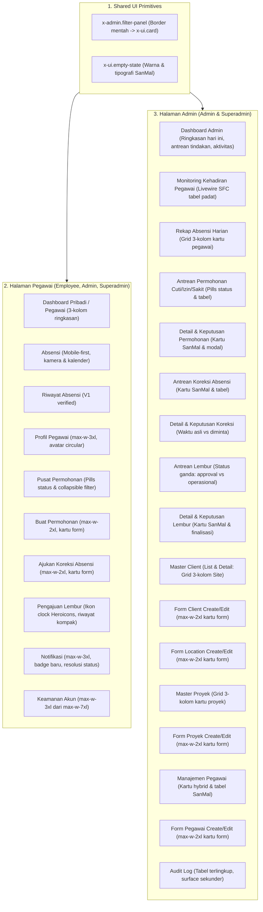

# Rencana Implementasi: Redesain & Standarisasi UI Seluruh Halaman (Desktop & Mobile)

Rencana ini menetapkan strategi penyelesaian antarmuka pengguna (UI/UX) untuk **seluruh halaman aplikasi PT SanMal**, baik pada tampilan desktop maupun mobile, mengikuti [SanMal Web Design Foundation](file:///home/ammar/Projects/pt-sanmal/docs/ui/DESIGN-FOUNDATION.md), [Page Inventory](file:///home/ammar/Projects/pt-sanmal/docs/ui/PAGE-INVENTORY.md), dan panduan skill `ui-ux-pro-max` serta `frontend-design`.

---

## 1. Deskripsi Tujuan

Menuntaskan standarisasi visual dan ergonomi interaksi seluruh halaman aplikasi internal PT SanMal:
1. **Styling & Decorating Komponen:** Menghilangkan semua border/background abu-abu mentah (`border-zinc-200`, `bg-white`, `border-neutral-200`) dan beralih ke token resmi SanMal (`x-ui.card` dengan borderless `shadow-sm`, permukaan `#F9FAFC` pada light theme dan `#192B40` pada dark theme).
2. **Compact 3-Column Layout:** Untuk daftar atau data yang tidak panjang (kartu lokasi site pada client, kartu proyek, ringkasan bulanan dashboard, kartu absensi harian per pegawai), data disajikan dalam **grid 3 kolom** (`grid-cols-1 md:grid-cols-2 lg:grid-cols-3`) agar informasi padat, ringkas, scannable, dan tidak memicu scroll vertikal berlebihan.
3. **Penyajian Data Berimbang & Mudah Dibaca:** Tipografi bersih (Inter), angka tabular untuk tanggal/ID/waktu, status badge semantik yang konsisten, serta kontras warna WCAG AA (minimal 4.5:1).
4. **Role Boundaries & Responsive Strategy:**
   - **Halaman Pegawai (Employee):** Diakses oleh Pegawai, Admin, dan Superadmin. Strategi **Mobile-First**, alur vertikal satu kolom pada layar sempit, target sentuh minimal 44–48 px, dan pengayaan tata letak di layar lebar.
   - **Halaman Admin (Admin/Superadmin):** Diakses hanya oleh Admin dan Superadmin. Strategi **Information-First** pada desktop/tablet untuk scanning data operasional dan monitoring, namun tetap mobile-friendly melalui scrolling terlingkup atau kartu adaptif.
5. **Integritas Sistem:** Mempertahankan 100% kontrak Livewire 4 SFC, routes, validasi, otorisasi, pagination, filtering, query, dan alur bukti kamera/GPS.

---

## 2. User Review Required

> [!IMPORTANT]
> **Keputusan Desain & Batasan Perilaku:**
> 1. **Tidak Ada Perubahan Logika Bisnis:** Semua controller, query Eloquent, otorisasi policy, middleware, skema database, formula absensi, dan Livewire action/lifecycle dipertahankan utuh.
> 2. **Layout 3 Kolom Responsif:** Grid 3 kolom diterapkan pada viewport `lg:` (desktop) atau `xl:`, sedangkan pada viewport tablet (`sm:` / `md:`) mengalir ke 2 kolom, dan pada mobile (`< 640px`) tetap 1 kolom demi kenyamanan satu tangan.
> 3. **Preservasi Assertion Test:** Beberapa pengujian fitur memeriksa string class spesifik (seperti `lg:grid-cols-2 xl:hidden` pada daftar pegawai admin, atau atribut `role="region"` pada tabel). Semua penanda yang diassert oleh test suite akan dipertahankan.

---

## 3. Rincian Perubahan per Halaman



---

### Bagian 1: Shared UI Components

#### [MODIFY] `resources/views/components/admin/filter-panel.blade.php`
- **Masalah Saat Ini:** Memakai class mentah `rounded-xl border border-neutral-200 bg-white p-4 dark:border-neutral-700 dark:bg-zinc-900`.
- **Perubahan:** Ganti menjadi pembungkus berbasis `<x-ui.card padding="p-4 sm:p-5">` dengan token permukaan SanMal (`bg-sanmal-surface-card dark:bg-sanmal-surface-card-dark shadow-sm`). Seluruh filter panel admin otomatis terangkat ke standar desain.

#### [MODIFY] `resources/views/components/ui/empty-state.blade.php`
- **Masalah Saat Ini:** Menggunakan style border slate yang kaku.
- **Perubahan:** Selaraskan container kosong dengan token `border-sanmal-border dark:border-sanmal-border-dark` dan latar belakang `bg-sanmal-surface-card dark:bg-sanmal-surface-card-dark`, sertakan ikon visual lembut di tengah bila ada.

---

### Bagian 2: Halaman Pegawai (Employee / Personal)

#### 1. Dashboard Pegawai (`resources/views/pages/dashboard.blade.php` - Branch `$isEmployee`)
- **Tampilan Desktop & Mobile:**
  - Ringkasan bulan disajikan dalam **3 kolom kartu ringkas** (`grid grid-cols-1 sm:grid-cols-3 gap-3`).
  - Bagian *Akses Cepat* dan *Pengajuan Saya* menggunakan kartu borderless `x-ui.card` dengan ikon Heroicons bertema SanMal.
  - Aktivitas absensi terbaru disusun dalam daftar scannable dengan badge status semantik (hijau/biru/amber).

#### 2. Absensi Pegawai (`resources/views/pages/employee/⚡attendance.blade.php`)
- **Tampilan Desktop & Mobile:**
  - Pertahankan alur kamera, izin GPS, livewire capture, dan form submit.
  - Pastikan kartu kalender mingguan/bulanan, ringkasan jam kerja, dan kartu info status absensi menggunakan elevasi `shadow-sm` tanpa border luar tambahan.

#### 3. Riwayat Absensi (`resources/views/pages/employee/attendance-history/index.blade.php`)
- **Status:** Telah selesai pada program V1 (`x-ui.card` borderless, indikator 3 kolom di desktop / mobile ringkas satu baris, filter collapsible, dialog detail event). Tetap dipertahankan.

#### 4. Profil Pegawai (`resources/views/pages/employee/⚡employee-profile.blade.php`)
- **Tampilan Desktop & Mobile:**
  - Batasi lebar form ke `max-w-3xl` agar tidak melar pada monitor ultra-wide.
  - Avatar circular dengan pemicu modal pratinjau `x-ui.photo-preview` dan tombol *Pilih file* sempit yang tidak mengganggu scrolling mobile.

#### 5. Pusat Permohonan (`resources/views/pages/employee/leave-requests/index.blade.php`)
- **Status:** Telah selesai dan diverifikasi di turn sebelumnya (toolbar quick filter pills, collapsible filter card dengan active badge, kartu responsif mobile dengan ikon per jenis permohonan, dan tabel desktop).

#### 6. Buat Permohonan (`resources/views/pages/employee/leave-requests/create.blade.php`)
- **Tampilan Desktop & Mobile:**
  - Wadah form dalam `x-ui.card` dengan lebar terarah `max-w-2xl`.
  - Grid tanggal mulai dan selesai 2 kolom pada tablet/desktop (`sm:grid-cols-2`), 1 kolom pada mobile.

#### 7. Ajukan Koreksi Absensi (`resources/views/pages/employee/attendance-corrections/create.blade.php`)
- **Tampilan Desktop & Mobile:**
  - Wadah form `x-ui.card` dengan `max-w-2xl`.
  - Pilihan event absensi dan info sesi anchor dalam callout yang mudah dipahami.

#### 8. Pengajuan Lembur Pegawai (`resources/views/pages/employee/overtime-requests/index.blade.php`)
- **Tampilan Desktop & Mobile:**
  - Koreksi bug nama ikon `flux:icon.clock-3` menjadi standard Heroicon `clock`.
  - Form pengajuan di atas dalam kartu bersih `max-w-3xl`.
  - Riwayat pengajuan di bawah menggunakan kartu rapi dengan pembeda jelas antara **Approval Status** (Menunggu/Disetujui/Ditolak) dan **Operational State** (Scheduled, Awaiting Photo, Completed).

#### 9. Notifikasi (`resources/views/pages/notifications/index.blade.php`)
- **Tampilan Desktop & Mobile:**
  - Halaman `max-w-3xl` terpusat.
  - Notifikasi yang belum dibaca diberi aksen warna SanMal (`before:bg-sanmal-brand-yellow-dark`), status badge *Baru*, dan tombol aksi tandai baca cepat.

#### 10. Keamanan Akun (`resources/views/pages/settings/⚡security.blade.php`)
- **Tampilan Desktop & Mobile:**
  - Ubah `max-width` halaman dari `max-w-7xl` tanpa batas menjadi `max-w-3xl` terfokus.
  - Kartu update email dan update kata sandi menggunakan `x-ui.card` dengan feedback password rules yang jelas.

---

### Bagian 3: Halaman Admin (Khusus Admin & Superadmin)

#### 11. Dashboard Administrasi (`resources/views/pages/dashboard.blade.php` - Branch `$isManager`)
- **Tampilan Desktop & Mobile:**
  - **Overview Kehadiran Hari Ini:** Kartu banner biru brand SanMal di atas dengan ringkasan 3 metrik dalam grid 3 kolom: *Belum lengkap*, *Perlu ditinjau*, dan *Belum ada catatan*.
  - **Antrean Tindakan (Action Queue):** Navigasi ringkas dengan hitungan tabular angka besar dan ikon berwarna.
  - **Daftar Aktivitas Absensi Terbaru:** Disajikan dalam tabel/kartu rapi dengan indikator kehadiran.

#### 12. Monitoring Kehadiran Pegawai (`resources/views/pages/admin/⚡kehadiran.blade.php`)
- **Tampilan Desktop & Mobile:**
  - Pertahankan table layout dan scoped horizontal scrolling pada desktop.
  - Filter toolbar menggunakan `x-ui.card` terpadu dengan chip filter tanggal, client, lokasi, dan proyek.
  - Tampilan mobile tetap menggunakan kartu adaptif (`.attendance-mobile-list`).

#### 13. Rekap Absensi Harian (`resources/views/pages/admin/daily-attendance.blade.php` & `components/admin/attendance/daily-employee-card.blade.php`)
- **Tampilan Desktop & Mobile (3-Column Compact):**
  - Ubah tumpukan baris kartu satu kolom vertikal menjadi **grid 3 kolom** pada desktop:
    `grid grid-cols-1 md:grid-cols-2 lg:grid-cols-3 gap-4`.
  - Kartu harian pegawai (`daily-employee-card`) dibuat padat dan proporsional: nama pegawai, nomor ID, badge status kehadiran harian, chip waktu clock-in/clock-out, dan tombol collapsible koreksi status yang rapi.
  - Filter bar tanggal dan tombol ekspor CSV bulanan ditata sejajar di bagian atas.

#### 14. Antrean Permohonan Cuti/Izin/Sakit (`resources/views/pages/admin/leave-requests/index.blade.php`)
- **Tampilan Desktop & Mobile:**
  - Ganti container border mentah dengan `<x-ui.card padding="p-0" class="overflow-hidden">`.
  - Tambahkan quick filter status pills (Semua, Menunggu, Disetujui, Ditolak).
  - Header tabel menggunakan surface sekunder `bg-sanmal-surface-secondary dark:bg-sanmal-surface-secondary-dark`.
  - Tampilan kartu scannable untuk mobile view (`md:hidden`).

#### 15. Detail & Keputusan Permohonan (`resources/views/pages/admin/leave-requests/show.blade.php`)
- **Tampilan Desktop & Mobile:**
  - Ganti raw border dengan `<x-ui.card padding="p-5 sm:p-6">`.
  - Grid metadata 2 kolom yang padat (`sm:grid-cols-2`): Pegawai, Jenis, Periode, Waktu Pengajuan, dan Lampiran.
  - Form keputusan admin di bawahnya dalam kartu tersendiri dengan modal konfirmasi yang aman.

#### 16. Antrean Koreksi Absensi (`resources/views/pages/admin/attendance-corrections/index.blade.php`)
- **Tampilan Desktop & Mobile:**
  - Bungkus daftar permohonan ke dalam `<x-ui.card padding="p-0" class="overflow-hidden">`.
  - Baris item menggunakan transisi warna `hover:bg-sanmal-surface-secondary/40` dan divider SanMal.
  - Informasi waktu diminta dan jenis koreksi ditampilkan padat dengan tombol *Tinjau*.

#### 17. Detail & Keputusan Koreksi Absensi (`resources/views/pages/admin/attendance-corrections/show.blade.php`)
- **Tampilan Desktop & Mobile:**
  - Wadah kartu `<x-ui.card padding="p-5 sm:p-6">` dengan `max-w-3xl`.
  - Bandingkan **Waktu bukti asli (immutable)** dengan **Waktu yang diminta** secara berdampingan dalam grid 2 kolom dengan penekanan visual yang jelas.
  - Tampilkan identitas snapshot pekerjaan (Client, Proyek, Lokasi) dalam callout inset `bg-sanmal-surface-inset`.

#### 18. Antrean Lembur (`resources/views/pages/admin/overtime-requests/index.blade.php`)
- **Tampilan Desktop & Mobile:**
  - Wadah kartu `<x-ui.card padding="p-0" class="overflow-hidden">`.
  - Dua dimensi status ditampilkan berdampingan: Badge Approval Status (Menunggu/Disetujui/Ditolak) dan Badge Operational State (Scheduled/Awaiting Photo/Completed/Cancelled).
  - Baris responsif: kartu pada mobile, baris tabel pada tablet/desktop.

#### 19. Detail & Keputusan Lembur (`resources/views/pages/admin/overtime-requests/show.blade.php`)
- **Tampilan Desktop & Mobile:**
  - Wadah `<x-ui.card padding="p-5 sm:p-6">` dengan `max-w-3xl`.
  - Tampilkan linimasa status operasional lembur, form keputusan persetujuan, tombol finalisasi, dan tombol pengecualian foto bila sesi clock-out bermasalah.

#### 20. Master Client List (`resources/views/pages/admin/clients/index.blade.php`)
- **Tampilan Desktop & Mobile:**
  - Bungkus setiap Client dalam kartu `<x-ui.card padding="p-4 sm:p-5">`.
  - Header kartu menampilkan Kode Client (font mono), Nama, Kontak, dan counter Location & Project.
  - **Sub-daftar Site Location dalam Client:** Disajikan dalam grid kompak multi-kolom yang rapi.

#### 21. Detail Client (`resources/views/pages/admin/clients/show.blade.php`)
- **Tampilan Desktop & Mobile (3-Column Compact):**
  - Daftar Site Location milik Client disusun dalam **grid 3 kolom**:
    `grid grid-cols-1 sm:grid-cols-2 lg:grid-cols-3 gap-3`.
  - Setiap kartu Site menampilkan: Nama site, badge status aktif/nonaktif, alamat, timezone, jumlah proyek terkait, dan tombol cepat *Ubah Location*.

#### 22. Form Client Create & Edit (`resources/views/pages/admin/clients/create.blade.php` & `edit.blade.php`)
- **Tampilan Desktop & Mobile:**
  - Wadah form dalam `<x-ui.card padding="p-5 sm:p-6">` dengan lebar terarah `max-w-2xl`.
  - Input Kode Client, Nama Client, Alamat, dan Nomor Telepon dengan label yang jelas.

#### 23. Form Location Create & Edit (`resources/views/pages/admin/locations/create.blade.php` & `edit.blade.php`)
- **Tampilan Desktop & Mobile:**
  - Wadah form dalam `<x-ui.card padding="p-5 sm:p-6">` dengan `max-w-2xl`.
  - Penanganan visual yang jelas antara jenis *Site milik Client* vs *Office Internal SanMal*. Input koordinat GPS (latitude, longitude, radius) dalam grid 2 kolom yang rapi.

#### 24. Master Proyek List (`resources/views/pages/admin/projects/index.blade.php`)
- **Tampilan Desktop & Mobile (3-Column Compact):**
  - Sajikan kartu proyek dalam **grid 3 kolom pada layar lebar**:
    `grid grid-cols-1 md:grid-cols-2 lg:grid-cols-3 gap-3`.
  - Menggunakan `<x-ui.card padding="p-4">`.
  - Ringkasan kartu menampilkan: Nama proyek, kode mono, badge jenis layanan (kalibrasi/pelatihan), badge status proyek, nama client, dan lokasi site. Detail deskripsi panjang dapat di-expand (`<details>`).

#### 25. Form Proyek Create & Edit (`resources/views/pages/admin/projects/create.blade.php`, `edit.blade.php`, `_form.blade.php`)
- **Tampilan Desktop & Mobile:**
  - Wadah form dalam `<x-ui.card padding="p-5 sm:p-6">` dengan `max-w-2xl`.
  - Grid 2 kolom untuk kode & nama proyek, client & jenis layanan, dan pilihan lokasi site.

#### 26. Manajemen Pegawai (`resources/views/pages/admin/employees/index.blade.php`)
- **Tampilan Desktop & Mobile:**
  - Ganti border mentah pada kartu mobile dengan `<x-ui.card>`.
  - Pertahankan assertion test `lg:grid-cols-2 xl:hidden` pada view kartu mobile/tablet.
  - Perbarui wadah tabel desktop (`hidden xl:block`) ke `<x-ui.card padding="p-0" class="overflow-hidden">` dengan `thead` bersurface sekunder SanMal.

#### 27. Form Pegawai Create & Edit (`resources/views/pages/admin/employees/create.blade.php` & `edit.blade.php`)
- **Tampilan Desktop & Mobile:**
  - Wadah form dalam `<x-ui.card padding="p-5 sm:p-6">` dengan `max-w-2xl`.
  - Field Nama, Email, Nomor Pegawai, Telepon, Jabatan, dan Tanggal Bergabung dalam layout yang nyaman diakses.

#### 28. Audit Log (`resources/views/pages/admin/audit-logs/index.blade.php`)
- **Tampilan Desktop & Mobile:**
  - Ganti border mentah tabel dengan `<x-ui.card padding="p-0" class="overflow-hidden">`.
  - Tabel terlingkup horizontal dengan `role="region"` yang tetap memenuhi test assertion.
  - Header tabel menggunakan warna sekunder `bg-sanmal-surface-secondary dark:bg-sanmal-surface-secondary-dark text-sanmal-text-muted`.

---

## 4. Rencana Verifikasi (Verification Plan)

### Automated Tests
1. **Pemeriksaan Linter & Kode (Laravel Pint):**
   ```bash
   ./vendor/bin/pint --test
   ```
2. **Pest Feature Tests Berdasarkan Fitur yang Berubah:**
   - Admin Client & Location:
     ```bash
     php artisan test tests/Feature/AdminClientLocationTest.php
     ```
   - Admin Project:
     ```bash
     php artisan test tests/Feature/AdminProjectTest.php
     ```
   - Admin Employee:
     ```bash
     php artisan test tests/Feature/AdminEmployeePageTest.php
     ```
   - Admin Attendance & Reporting:
     ```bash
     php artisan test tests/Feature/AdminAttendancePageTest.php tests/Feature/AdminReportingTest.php
     ```
   - Request Center & Workflows (Leave, Overtime, Correction):
     ```bash
     php artisan test tests/Feature/RequestCenterTest.php tests/Feature/LeaveRequestWorkflowTest.php tests/Feature/OvertimeWorkflowTest.php tests/Feature/AttendanceCorrectionWorkflowTest.php
     ```
   - Dashboard & Settings:
     ```bash
     php artisan test tests/Feature/DashboardTest.php tests/Feature/Settings/SecurityTest.php tests/Feature/EmployeeProfileTest.php
     ```
   - Shared UI Components:
     ```bash
     php artisan test tests/Feature/UiCardComponentTest.php tests/Feature/UiFeedbackComponentsTest.php tests/Feature/UiLayoutComponentsTest.php
     ```
3. **Pemeriksaan Seluruh Test Suite Repository:**
   ```bash
   php artisan test
   ```
   *Target: 302 test, 300+ passed, 0 failed.*

### Manual / Browser Verification
- **Viewport Checkpoints:**
  - Small Mobile (375 px / 390 px): Pastikan tata letak 1 kolom, touch target minimal 44 px, tidak ada horizontal overflow pada dokumen utama.
  - Tablet (768 px / 820 px): Periksa reflow grid 2 kolom pada kartu proyek dan client site.
  - Desktop (1280 px – 1440 px): Pastikan tata letak grid 3 kolom pada kartu lokasi client, kartu proyek, dan kartu kehadiran rekap harian tampil proporsional, padat, dan mudah dipindai tanpa ruang kosong yang timpang.
- **Theme Check:**
  - Light mode: Permukaan kartu `#F9FAFC` di atas halaman `#F2F5F8`, bayangan `shadow-sm`, kontras teks primary `#172033`.
  - Dark mode: Permukaan kartu `#192B40` di atas halaman `#0B1623`, bayangan `dark:shadow-black/20`, teks terang `#F1F5F9`.

---

## 5. Pertanyaan & Konfirmasi (Open Questions)

Semua aspek teknis dan batas peran (employee vs admin) sudah dipetakan dengan jelas sesuai instruksi. Silakan periksa rencana di atas dan klik **Proceed** atau berikan masukan bila ada preferensi tambahan sebelum kita memulai implementasi menyeluruh.
